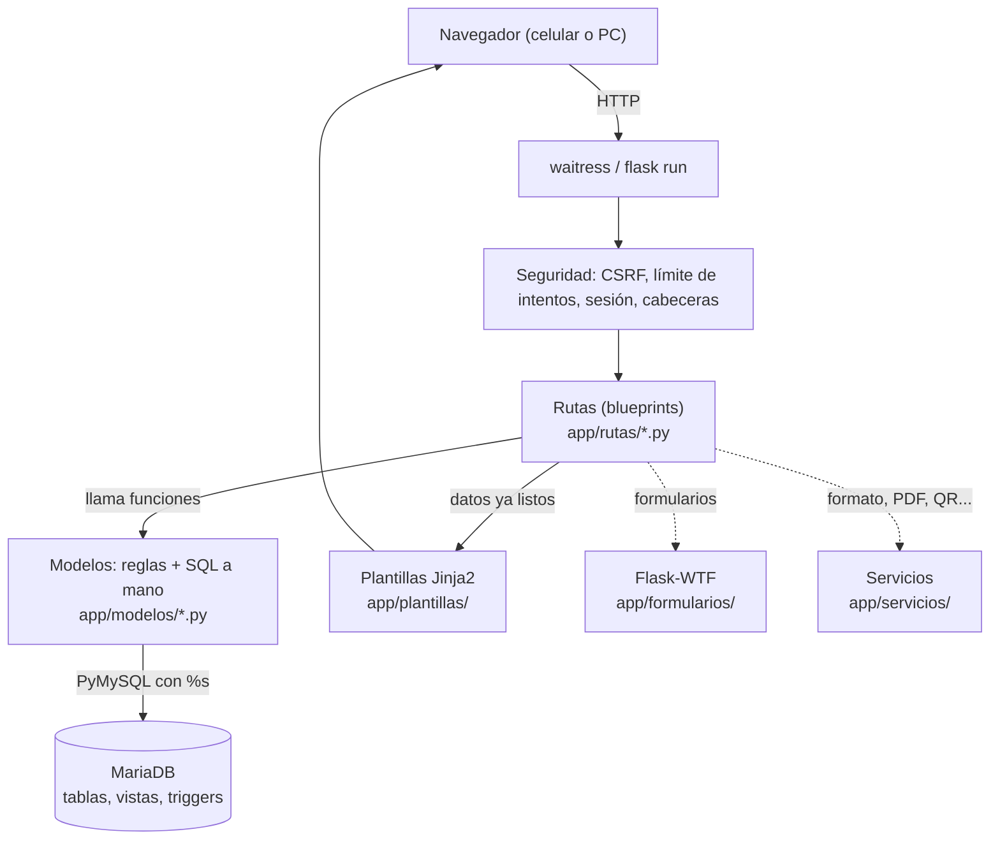
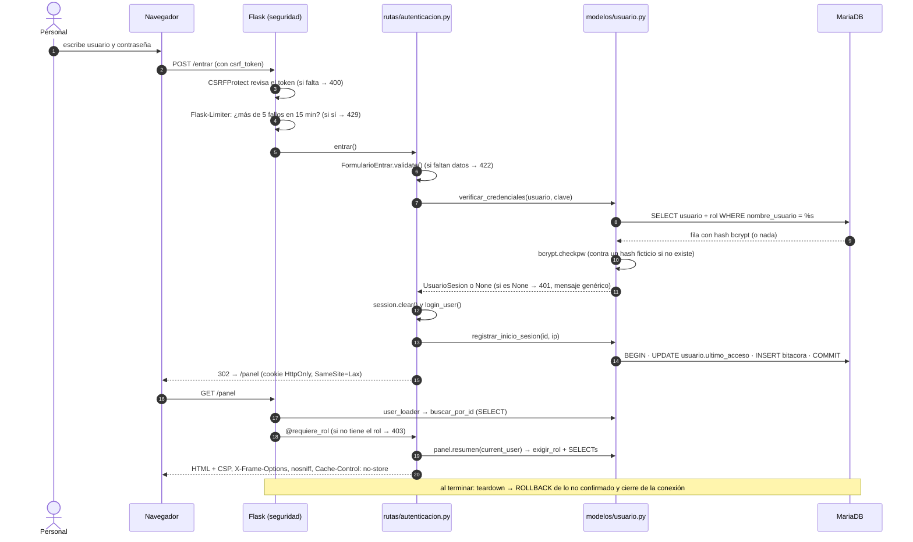
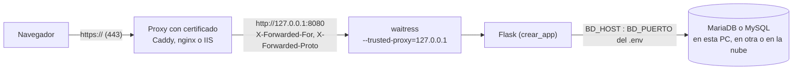

# Arquitectura de Titicaca Vivo

## Capas



| Capa | Carpeta | Qué hace | Qué NO hace |
|---|---|---|---|
| Rutas | `app/rutas/` | Lee la petición, valida el formulario, llama al modelo, elige la plantilla y el código HTTP. | **No escribe SQL.** |
| Modelos | `app/modelos/` | Reglas de negocio (RN-xx), revisa el rol otra vez y ejecuta todo el SQL, con un comentario que dice qué devuelve cada consulta. | No sabe de HTML ni de `request`. |
| Plantillas | `app/plantillas/` | Muestra los datos que le pasan. | **No consulta la base** ni tiene datos fijos del negocio. |
| Base | `database/` | Restricciones (CHECK, FK, UNIQUE) y triggers: la red de seguridad. | No es el lugar principal de las reglas (eso es el modelo). |

Archivos de apoyo:

| Archivo | Qué hace |
|---|---|
| `app/bd.py` | Conexión por petición en `flask.g`, `transaccion()`, `consultar()`. |
| `app/rutas/` | 5 blueprints: `publico`, `autenticacion`, `reservas`, `panel` (`/panel/...`, con las rutas de la F6 en `panel_seguimiento.py`) y `catalogos` (`/panel/catalogos/...`, F5). |
| `app/servicios/textos.py` | Idioma del turista (D-90): `t()`, `mensaje()` y el diccionario `textos_en.py`. `g.idioma` se fija en cada petición (en el panel, siempre español). |
| `app/seguridad.py` | Sesión, CSRF, límite de intentos, `@requiere_rol`, cabeceras. |
| `app/errores.py` | Páginas 400, 403, 404, 405, 429 y 500. |
| `app/registro.py` | `logs/app.log`, en hora de Lima. |
| `app/config.py` | Todo sale del `.env`. |

## Recorrido de una petición: iniciar sesión



## La conexión y las transacciones

- **Una conexión por petición.** `bd.obtener_conexion()` la abre la primera vez que se necesita y la guarda en `flask.g`. Al terminar la petición, `cerrar_conexion()` hace ROLLBACK de lo que no se confirmó y la cierra.
- **autocommit apagado.** Un cambio solo queda si se ejecuta COMMIT:

  ```python
  with bd.transaccion() as cur:      # COMMIT si todo sale bien; ROLLBACK si hay una excepción
      cur.execute("UPDATE ...", (...,))
      cur.execute("INSERT ...", (...,))
  ```

- **Lectura actual (F4 y F5).** Las operaciones que cuentan cupos o revisan cruces usan `bd.transaccion(lectura_actual=True)`: descarta lo leído antes en la petición, abre la transacción en READ COMMITTED y luego bloquea las filas con `FOR UPDATE` (D-50, D-65). Para no producir interbloqueos, el orden de los bloqueos es siempre el mismo: primero la salida (o la lancha) y después la reserva (D-68).
- **Cada conexión arranca con** `SET time_zone = '-05:00', SESSION sql_mode = 'STRICT_TRANS_TABLES,…'`: hora de Lima (RN-15) y modo estricto (D-16).
- **Parámetros siempre con `%s`.** PyMySQL escapa los valores, así que el texto del usuario nunca se mezcla con el SQL.

## Seguridad (sección 11)

| Requisito | Dónde |
|---|---|
| CSRF en todo POST | `CSRFProtect` (global) + `{{ formulario.csrf_token }}` / `csrf_token()` |
| Contraseñas con bcrypt | `modelos/usuario.py` (costo 12) |
| Máximo 5 intentos fallidos cada 15 min, con mensaje genérico | `@limitador.limit(..., deduct_when=solo los fallidos)` en `/entrar` |
| Cookies HttpOnly, SameSite=Lax, Secure en producción | `config.py` |
| CSP `'self'`, `X-Frame-Options: DENY`, `nosniff` | `seguridad.agregar_cabeceras` |
| `Cache-Control: no-store` con datos personales | `/panel/*` (before_request), `/entrar`, `/salud` |
| Páginas 403/404/500 sin trazas | `errores.py` (el detalle va a `logs/app.log`) |
| Redirección solo a rutas internas (`?next=`) | `seguridad.destino_seguro` |
| Secretos solo en `.env` | `config.py` + `.env.example` |
| Cookie `Secure` en producción, por HTTPS | Proxy delante de waitress, que confía solo en él (D-101) |

## En producción: HTTPS y otro servidor de base de datos (F8)



- **HTTPS (D-101).** waitress no atiende HTTPS: lo hace el proxy. waitress confía en las cabeceras `X-Forwarded-*` **solo** si vienen del proxy. Así la app conoce la IP real de cada turista (para el límite de `/entrar` y la bitácora) y sabe que la petición llegó por https (cookie `Secure`). El código no cambia: son opciones de `waitress-serve`.
- **Otro servidor de base de datos (Platino, D-100).** La conexión sale entera del `.env` (`BD_HOST`, `BD_PUERTO`, `BD_USUARIO`, `BD_CONTRASENA`, `BD_NOMBRE`). Cambiar de servidor es cambiar esas líneas.
- La guía completa y las pruebas están en [fase-8-entrega.md](fase-8-entrega.md).

## Registro (logs)

`logs/app.log` (rota a 1 MB, guarda 5 archivos) guarda, con la hora de Lima (`2026-10-19 23:08:52-0500`):

- los arranques;
- los inicios de sesión;
- los avisos de `/salud` cuando la base no responde;
- los errores 500 con su traza completa (que el usuario nunca ve).
