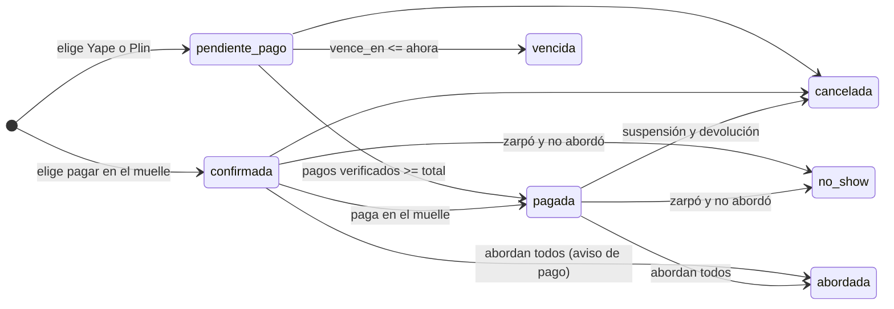
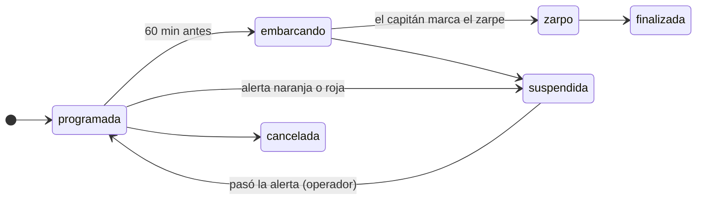

# Fase 0 · Análisis de "Titicaca Vivo"

> Estado: entregada el 19/10/2026. Espera el "ok" del equipo para pasar a la F1.
> En esta fase no hay código de la aplicación. Lo único nuevo fuera de `docs/` es el logo (`app/estaticos/img/`), que el equipo pidió aparte.

Documentos de esta fase:

- este archivo: resumen, supuestos, preguntas y estados;
- [modelo-datos.md](modelo-datos.md): diagrama ER, diccionario de las 20 tablas, relaciones y ON DELETE;
- [decisiones.md](decisiones.md): decisiones, propuestas (logo y nombre) y pendientes.

---

## 1. Resumen: lo que entendimos

1. Rehacemos "Titicaca Reservas" (v1: Node, 5 tablas) como **Titicaca Vivo**, en Flask 3.1 + MariaDB 10.4 (XAMPP), con SQL escrito a mano en PyMySQL y sin ORM.
2. Los 5 conceptos de la v1 siguen ahí (comunidad, usuario, salida, turista y reserva) y el modelo crece a 20 tablas.
3. El turista, sin crear cuenta, ve las salidas por día y por ruta y reserva para él y sus acompañantes. Recibe un boleto con QR y paga por Yape o Plin (lo reporta) o en el muelle.
4. Lo central es **reservar sin sobreventa**: una sola transacción con `SELECT … FOR UPDATE` sobre la salida, más un `token_envio` UNIQUE para que un doble clic no duplique la reserva.
5. El precio sale de la tarifa por tipo de pasajero y del recargo de la temporada, y queda congelado en `precio_aplicado`.
6. El personal (admin, operador, guía y capitán) usa un panel cuyos permisos se revisan en la ruta (`@requiere_rol`) y otra vez en el modelo.
7. La operación incluye salidas con reglas de lancha, capitán y horarios que no se crucen, verificación de pagos, abordaje por QR (de 60 min antes a 15 min después del zarpe), manifiesto en PDF y lista para WhatsApp por wa.me.
8. Lo propio de Puno: rotación justa de familias anfitrionas con reporte de transparencia, alertas del lago con suspensión y reprogramación, modo de baja señal, mapa SVG propio y textos en español e inglés.
9. Las reglas viven en Python. Los triggers son solo una red de seguridad. Todo corre en hora de Lima (−05:00).
10. Se trabaja por fases (F0 a F8), con pruebas, EXPLAIN y documentación para que el equipo pueda defender cada SELECT ante el docente (de Bronce a Platino).

---

## 2. Supuestos

Si un supuesto está mal, basta con decirlo y lo corregimos antes de la F1.

### Proyecto y entorno

- **S-01.** El proyecto vive en `TURISMO PROGRAMA/titicaca_vivo/`, que es la raíz de la sección 13.
- **S-02.** Revisamos la PC del equipo:
  - MariaDB **10.4.32** de XAMPP: cumple;
  - solo hay **Python 3.11**, y el stack pide 3.12 o 3.13. Antes de la F1 hay que instalar Python 3.13 (ver pendientes).
- **S-03.** La carpeta está dentro de **OneDrive**. El `venv` (miles de archivos) no debe sincronizarse: lo crearemos como `.venv` y pediremos excluirlo, o lo pondremos fuera de OneDrive. Lo explicaremos en el README.

### Dinero y hora

- **S-04.** Todo se cobra en **soles (S/)**, sin dólares. Los montos se guardan en DECIMAL y se redondean a 2 decimales con `ROUND(…, 2)`.
- **S-05.** Todas las fechas DATETIME se guardan en hora de Lima, sin zona. Cada conexión ejecuta `SET time_zone = '-05:00'`, de modo que `NOW()` y `CURRENT_TIMESTAMP` dan hora de Lima. En Python usamos `ZoneInfo("America/Lima")`.

### Reservas y cupos

- **S-06.** Los **ocupados** se cuentan en `reserva_pasajero` (RN-01). Si el titular viaja, también es una fila de pasajero (ver pregunta P1).
- **S-07.** Que un documento no se repita en la misma salida (RN-09) **no puede ser un UNIQUE**: `reserva_pasajero` no tiene `salida_id`, y las reservas canceladas o vencidas no deben bloquear a nadie. Se valida en el modelo, dentro de la transacción con FOR UPDATE, y el trigger lo vuelve a revisar.
- **S-08.** El turista se identifica por `(tipo_documento, numero_documento)`. Si ya existe, se reutiliza su fila. Sus datos de contacto solo se actualizan si los nombres y apellidos coinciden (sin tildes ni mayúsculas). Si no coinciden, se responde 422 con "este documento ya está registrado con otro nombre; escribe a la agencia".
- **S-09.** El código de reserva es `TV-` más 4 caracteres de un alfabeto de 31 (A–Z sin I, L ni O, más los dígitos 2–9). Eso da 31⁴ = 923 521 códigos. Se generan con `secrets` y, si uno choca (error 1062), se reintenta.
- **S-10.** `token_envio` son 32 caracteres hexadecimales (`secrets.token_hex(16)`), generados al mostrar el formulario.
- **S-11.** Transiciones de la reserva (ver la sección 5):
  - `confirmada` (paga en el muelle) puede abordar; el panel avisa que falta el pago;
  - `no_show` lo marca el operador, o un comando, para las reservas que no abordaron cuando la salida ya zarpó.
- **S-12.** Se aceptan **pagos parciales**. La reserva pasa a `pagada` solo cuando la suma de los pagos verificados es igual o mayor que el total. Un pago rechazado no suma.

### Precios

- **S-13.** Tarifa vigente: `vigente_desde <= fecha_salida` y (`vigente_hasta` es NULL o `>= fecha_salida`). Si hay varias, gana la de `vigente_desde` más reciente. Si un tipo de pasajero no tiene tarifa vigente, no se puede reservar con ese tipo.
- **S-14.** Las temporadas no se solapan (lo valida el modelo). Si por error se solaparan, se aplica el recargo mayor, para que el resultado no dependa del azar. Precio = `ROUND(precio_base × (1 + recargo / 100), 2)`.
- **S-15.** El tipo de pasajero lo declara el turista. La tabla no tiene fecha de nacimiento, así que las edades de `tipo_pasajero` son solo informativas y el documento se revisa en el muelle. (La propuesta de validar más va en decisiones.md.)

### Pernocte y familias

- **S-16.** Una ruta con pernocte tiene **una sola** parada con `es_pernocte = 1`. La noche es `DATE(fecha_hora_zarpe)`.
- **S-17.** Una salida de 2 días ocupa la lancha **desde el zarpe hasta el retorno**. Así pasa en el tour real: la lancha y el capitán se quedan en Amantaní. Dos salidas se cruzan si `a.zarpe < b.retorno AND b.zarpe < a.retorno`.
- **S-18.** Una familia recibe **una sola reserva por noche** ("libre esa noche"). En rutas con pernocte, al reservar se comprueba que haya al menos una familia libre con capacidad para el grupo. Si no la hay, no se deja reservar y se sugiere dividir el grupo o escribir a la agencia (ver P4).
- **S-19.** Rotación (RN-10): las "noches en los últimos 30 días" se cuentan entre `noche − 30 días` y `noche − 1 día`, con estado `asignado` o `cumplido`. "Más tiempo esperando" es la familia cuya última noche es más antigua; si nunca recibió a nadie, va primero.
- **S-20.** `hospedaje` tiene UNIQUE(`reserva_id`, `fecha_noche`):
  - reasignar es un UPDATE de `familia_id` en la misma fila, y la familia anterior queda en la bitácora;
  - si se reprograma a otra fecha, la fila vieja pasa a `cancelado` y se crea una nueva.

### Salidas, alertas, abordaje y bitácora

- **S-21.** "Salida afectada" por una alerta (RN-11) se calcula, no se guarda. Es una salida `programada` o `embarcando` cuyo horario se cruza con el de una alerta naranja o roja, y la alerta es de todo el lago (`comunidad_id` NULL) o de una comunidad de su ruta.
- **S-22.** Reprogramar **actualiza la misma reserva**:
  - `salida_id` pasa a la nueva salida y `reprogramada_desde_salida_id` guarda la anterior;
  - se conservan los precios y los pagos (la suspensión no es culpa del turista);
  - se bloquean las dos salidas en orden de id para evitar interbloqueos (*deadlocks*).
- **S-23.** El QR abre `/panel/abordaje/<codigo>`:
  - aparecen los pasajeros de la reserva, todos marcados, y se confirma con un clic;
  - pueden registrar el guía y el capitán asignados a esa salida, y también el operador;
  - la ventana de RN-12 se calcula en hora de Lima.
- **S-24.** El cambio de estado de una salida lo escribe en la bitácora **el trigger** (lo pide el enunciado), no el modelo, para no duplicarlo. Antes del UPDATE, el modelo ejecuta `SET @app_usuario_id = %s, @app_ip = %s` y el trigger lee esas variables. Los demás cambios (reserva, pago, hospedaje e inicio de sesión) los registra el modelo.
- **S-25.** Las acciones del turista quedan en la bitácora con `usuario_id` NULL. Con waitress sin proxy, la IP sale de `request.remote_addr`.
- **S-26.** Roles:
  - el admin maneja usuarios, catálogos y bitácora, y ve la operación en modo lectura;
  - el operador hace toda la operación y los catálogos;
  - los detalles irán en `docs/matriz-permisos.md` (F2).

### Datos reales de Puno (para la semilla)

Lo marcado "por confirmar" se valida con Giant Trip o con la comunidad antes de la F1.

| Comunidad | Distrito | Provincia | Idioma | Señal | Hospedaje vivencial | Nota |
|---|---|---|---|---|---|---|
| Uros (islas flotantes) | Puno | Puno | aimara | buena (por confirmar) | sí | Cerca del muelle de Puno. Hoy hablan aimara. |
| Taquile | Amantaní | Puno | quechua | débil (por confirmar) | sí | Su arte textil es Patrimonio Inmaterial de la UNESCO (2008). |
| Amantaní | Amantaní | Puno | quechua | débil (por confirmar) | sí | Templos de Pachamama y Pachatata. Principal destino de pernocte. |
| Llachón | Capachica | Puno | quechua | débil (por confirmar) | sí | Península de Capachica. Pionera del turismo vivencial. |
| Luquina Chico | Chucuito | Puno | aimara | por confirmar | sí | Turismo vivencial en la península de Chucuito. |
| Ticonata | Capachica | Puno | quechua | por confirmar | sí | Isla pequeña frente a Capachica. |

- **S-27.** Las 4 rutas de la semilla:

  | Código | Ruta | Duración | Pernocte |
  |---|---|---|---|
  | `URO-MD` | Uros, medio día | unas 3 h | no |
  | `URO-TAQ` | Uros + Taquile, día completo | unas 9 h | no |
  | `URO-AMA-TAQ` | Uros + Amantaní (pernocte) + Taquile | 2 días | Amantaní |
  | `LLA-VIV` | Llachón vivencial | 2 días (por confirmar) | Llachón (por confirmar) |

  Llachón también se alcanza por carretera, pero el sistema solo maneja salidas en lancha.
- **S-28.** Temporadas de la semilla:
  - **Candelaria**: la Festividad de la Virgen de la Candelaria (Patrimonio Inmaterial de la UNESCO, 2014) cae en febrero, con su día central el 2. Las fechas exactas de los concursos cambian cada año (por confirmar);
  - **temporada alta**: de junio a agosto (por confirmar con la agencia).
- **S-29.** Las personas de la semilla (turistas, familias y personal) son ficticias. Los nombres de familia usarán apellidos frecuentes de la zona, sin datos reales.

---

## 3. Preguntas (cada una con nuestra recomendación)

Si no hay respuesta, aplicamos la recomendación y la dejamos anotada en decisiones.md.

**P1. ¿El titular viaja siempre?**
La tabla `turista` (titular) está separada de `reserva_pasajero`, y los cupos se cuentan con los pasajeros.
*Recomendación:* en el formulario, la casilla "Yo también viajo" viene marcada y copia al titular como pasajero 1. Si se desmarca, el titular no ocupa lugar (por ejemplo, un padre que reserva para sus hijos).

**P2. ¿Qué pasa si el turista reporta su pago Yape o Plin y la reserva vence antes de que el operador lo verifique?**
Hoy, una reserva que paga a la hora 1:50 y se verifica a las 3:00 perdería su cupo.
*Recomendación:* al **reportar** el pago, `vence_en` se amplía hasta 60 minutos antes del zarpe, porque la reserva ya no está abandonada. Si el operador **rechaza** el pago, `vence_en` vuelve a ser "ahora + 2 h" (como mínimo).

**P3. ¿De dónde sale `hospedaje.monto_familia`?**
El modelo lo guarda, pero no dice cómo se calcula.
*Recomendación:* `monto_familia = personas × pago por persona y noche`. Ese pago es un valor de configuración (`PAGO_FAMILIA_PERSONA_NOCHE` en el `.env`, por ejemplo S/ 40.00, por confirmar con Giant Trip) y se copia como foto en cada hospedaje. Si cada comunidad cobra distinto, la alternativa es agregar una columna en `comunidad`.

**P4. Devolución por suspensión: ¿dónde la registramos?**
El modelo de 20 tablas no tiene un lugar para la solicitud de devolución.
*Recomendación:* sin columnas nuevas:
- la reserva pasa a `cancelada` y se escribe en la bitácora `accion = 'devolucion_solicitada'`, con el monto verificado en el JSON;
- el panel lista las solicitudes que aún no tienen su `devolucion_atendida`, que el operador marca cuando devuelve el dinero a mano.

La alternativa es agregar a `reserva` las columnas `devolucion_estado` y `devolucion_solicitada_en`.

**P5. Crédito visible de las fotos: ¿lo guardamos en la base?**
La Plata exige "cero datos fijos en el HTML", pero `comunidad` no tiene dónde guardar el crédito de la foto.
*Recomendación:* agregar una columna `comunidad.foto_credito VARCHAR(200) NULL`. El archivo de la foto se nombra por el slug (`img/comunidades/<slug>.webp`) y se pone la lista completa en `docs/creditos-imagenes.md`.

---

## 4. Diagrama ER y 5. Diccionario de datos

Están en [modelo-datos.md](modelo-datos.md): el ER completo en Mermaid con las 20 tablas, el diccionario columna por columna, la cardinalidad de cada relación y el porqué de cada ON DELETE.

---

## 6. Ciclo de vida (estados)





---

## 7. Para explicar al docente

**1. ¿Qué es una PK, una FK y un ON DELETE en nuestro modelo?**
La **PK** (`id`) identifica cada fila. La **FK** es una columna que apunta a la PK de otra tabla: `salida.ruta_id` dice "esta salida es de esa ruta", y la base no deja escribir una ruta que no existe.
Con **ON DELETE RESTRICT**, MariaDB no deja borrar una ruta que tiene salidas: la historia no se pierde. En vez de borrar, se desactiva (`activa = 0`).
Solo dos hijos usan **CASCADE**: `ruta_parada` y `reserva_pasajero`, porque sin su padre no significan nada.

**2. ¿Por qué los cupos libres se calculan y no se guardan?**
Si guardáramos "libres = 12" en `salida`, cada reserva, cancelación o vencimiento tendría que actualizar ese número. Bastaría un olvido para que mienta.
Por eso los contamos cada vez:

```sql
-- Devuelve cuántos pasajeros ocupan lugar en la salida 7 (RN-01).
SELECT COUNT(*) AS ocupados
FROM reserva_pasajero rp
JOIN reserva r ON r.id = rp.reserva_id
WHERE r.salida_id = 7
  AND (r.estado IN ('confirmada','pagada','abordada')
       OR (r.estado = 'pendiente_pago' AND r.vence_en > NOW()));
```

Así, una reserva vencida deja de contar sola, aunque nadie ejecute el comando `vencer`.

**3. ¿Por qué `temporada` no tiene FK hacia `salida`?**
La temporada depende de la **fecha**, no de una salida en particular: "Candelaria" va, por ejemplo, del 1 al 15 de febrero, y una salida cae dentro o fuera de ese rango.
Con una FK habría que guardar la temporada en cada salida y mantenerla al día si el rango cambia, con el riesgo de que no coincida. Por eso se busca con `WHERE fecha BETWEEN fecha_inicio AND fecha_fin`.
Además, el precio ya queda congelado en `precio_aplicado`, así que cambiar una temporada no altera las reservas hechas.

---

## 8. Pendientes que deja esta fase

- Instalar **Python 3.13** (en la PC solo está la 3.11).
- Responder P1 a P5 y confirmar los datos "por confirmar" (señal, Llachón, fechas de temporadas y pago a las familias).
- Aprobar el logo y el nombre (ver decisiones.md, PR-01 y PR-02).
