# Modelo de datos de Titicaca Vivo

> Versión F3: coincide con `database/01_esquema.sql` y `02_vistas_triggers.sql` (20/10/2026). La F3 agregó `comunidad.latitud` y `comunidad.longitud`.
> Motor InnoDB · `utf8mb4` · `utf8mb4_spanish_ci` · MariaDB 10.4.32 (XAMPP).

## De la v1 a la v2

| v1 (Titicaca Reservas) | v2 (Titicaca Vivo) | Qué cambia |
|---|---|---|
| `comunidad_destino` | `comunidad` | Suma idioma, señal y hospedaje. Se une a las rutas mediante `ruta_parada`. |
| `usuario_sistema` | `usuario` + `rol` | Los roles pasan a una tabla propia. Se suman licencia (capitán) y comunidad (guía). |
| `salida` | `salida` | Suma lancha, capitán, guía y estados. |
| `turista` | `turista` | Pasa a ser solo el titular. Los acompañantes van en `reserva_pasajero`. |
| `reserva` | `reserva` | Suma código TV-XXXX, estados de pago, token y reprogramación. |

## Convenciones

- PK: `id INT UNSIGNED AUTO_INCREMENT` (en `bitacora`, `BIGINT UNSIGNED`).
- Toda FK lleva índice y usa `ON DELETE RESTRICT`. Las excepciones son `ruta_parada.ruta_id` y `reserva_pasajero.reserva_id`, que usan `CASCADE`. `ON UPDATE` queda en RESTRICT, porque los `id` nunca cambian.
- Los estados van como ENUM y el dinero como DECIMAL (nunca FLOAT). Los sí/no van como `BOOLEAN` (= `TINYINT(1)`).
- Las fechas de registro usan `DATETIME DEFAULT CURRENT_TIMESTAMP`, en hora de Lima (`SET time_zone = '-05:00'`).
- Un CHECK no puede leer otras tablas ni usar `NOW()`. Esas reglas viven en el modelo (Python) y, como respaldo, en los triggers.

---

## Diagrama ER (las 20 tablas)

```mermaid
erDiagram
    rol ||--o{ usuario : "asigna"
    comunidad |o--o{ usuario : "tiene guias"
    comunidad ||--o{ familia_anfitriona : "agrupa"
    ruta ||--o{ ruta_parada : "recorre"
    comunidad ||--o{ ruta_parada : "es parada de"
    ruta ||--o{ tarifa : "cobra"
    tipo_pasajero ||--o{ tarifa : "precio para"
    ruta ||--o{ salida : "se opera en"
    embarcacion ||--o{ salida : "realiza"
    usuario ||--o{ salida : "capitanea"
    usuario |o--o{ salida : "guia"
    usuario ||--o{ salida : "crea"
    salida ||--o{ reserva : "recibe"
    salida |o--o{ reserva : "reprogramada desde"
    turista ||--o{ reserva : "es titular de"
    reserva ||--|{ reserva_pasajero : "incluye"
    tipo_pasajero ||--o{ reserva_pasajero : "clasifica"
    reserva ||--o{ pago : "recibe"
    usuario |o--o{ pago : "verifica"
    reserva ||--o{ hospedaje : "genera"
    familia_anfitriona ||--o{ hospedaje : "acoge"
    reserva_pasajero ||--o{ abordaje : "aborda"
    salida ||--o{ abordaje : "registra"
    usuario ||--o{ abordaje : "marca"
    comunidad |o--o{ alerta_lago : "afectada por"
    usuario ||--o{ alerta_lago : "registra"
    reserva ||--o| resena : "recibe"
    usuario |o--o{ resena : "modera"
    usuario |o--o{ bitacora : "genera"

    rol {
        INT id PK
        VARCHAR codigo UK "admin, operador, guia, capitan"
        VARCHAR nombre
        VARCHAR descripcion
    }
    usuario {
        INT id PK
        INT rol_id FK
        VARCHAR nombre_usuario UK
        VARCHAR nombre_completo
        VARCHAR correo UK "NULL"
        VARCHAR telefono
        CHAR hash_contrasena "bcrypt"
        INT comunidad_id FK "NULL, obligatorio si es guia"
        VARCHAR licencia_navegacion "NULL, obligatoria si es capitan"
        BOOLEAN activo
        DATETIME ultimo_acceso
        DATETIME creado_en
    }
    comunidad {
        INT id PK
        VARCHAR nombre UK
        VARCHAR slug UK
        VARCHAR distrito
        VARCHAR provincia
        ENUM idioma_originario "quechua, aimara"
        ENUM senal "buena, debil, sin_senal"
        VARCHAR whatsapp_contacto
        TEXT descripcion
        VARCHAR foto_credito "NULL"
        DECIMAL latitud "9,6 NULL"
        DECIMAL longitud "9,6 NULL"
        BOOLEAN tiene_hospedaje
        BOOLEAN activa
    }
    familia_anfitriona {
        INT id PK
        INT comunidad_id FK
        VARCHAR nombre_familia
        VARCHAR responsable
        VARCHAR telefono
        TINYINT capacidad_personas "CHECK 1 a 10"
        SET servicios "desayuno, almuerzo, cena, vestimenta, taller_textil"
        BOOLEAN activa
        DATETIME registrada_en
    }
    embarcacion {
        INT id PK
        VARCHAR nombre
        VARCHAR matricula UK
        TINYINT capacidad_maxima "CHECK 1 a 40"
        ENUM tipo "lancha, deslizador, balsa_totora"
        ENUM estado "operativa, mantenimiento, baja"
        DATE ultimo_mantenimiento
    }
    ruta {
        INT id PK
        VARCHAR codigo UK
        VARCHAR nombre
        TEXT descripcion
        DECIMAL duracion_horas "4,1"
        BOOLEAN incluye_pernocte
        VARCHAR muelle_salida
        BOOLEAN activa
    }
    ruta_parada {
        INT id PK
        INT ruta_id FK "CASCADE"
        INT comunidad_id FK
        TINYINT orden "UK con ruta_id"
        SMALLINT minutos_estadia
        BOOLEAN es_pernocte
    }
    temporada {
        INT id PK
        VARCHAR nombre
        DATE fecha_inicio
        DATE fecha_fin "CHECK >= fecha_inicio"
        DECIMAL recargo_porcentaje "5,2 CHECK 0 a 100"
    }
    tipo_pasajero {
        INT id PK
        VARCHAR codigo UK
        VARCHAR nombre
        TINYINT edad_minima
        TINYINT edad_maxima "NULL"
    }
    tarifa {
        INT id PK
        INT ruta_id FK
        INT tipo_pasajero_id FK
        DECIMAL precio_base "8,2 CHECK > 0"
        DATE vigente_desde
        DATE vigente_hasta "NULL"
    }
    salida {
        INT id PK
        INT ruta_id FK
        INT embarcacion_id FK
        INT capitan_id FK
        INT guia_id FK "NULL"
        DATETIME fecha_hora_zarpe
        DATETIME fecha_hora_retorno "CHECK > zarpe"
        SMALLINT cupo "CHECK >= 1"
        ENUM estado "programada ... cancelada"
        VARCHAR motivo_estado "NULL"
        INT creada_por FK
        DATETIME creada_en
        DATETIME actualizada_en
    }
    turista {
        INT id PK
        VARCHAR nombres
        VARCHAR apellidos
        ENUM tipo_documento "DNI, CE, PASAPORTE"
        VARCHAR numero_documento "UK con tipo"
        CHAR nacionalidad "ISO 3166-1 alfa-2"
        VARCHAR telefono "NULL"
        VARCHAR correo "NULL"
        ENUM idioma "es, en"
        DATETIME creado_en
    }
    reserva {
        INT id PK
        CHAR codigo UK "TV-XXXX"
        INT salida_id FK
        INT turista_id FK
        ENUM estado "pendiente_pago ... no_show"
        ENUM metodo_pago_elegido "yape, plin, muelle"
        DECIMAL total "10,2"
        DATETIME vence_en "NULL"
        CHAR token_envio UK "32"
        ENUM canal "web, whatsapp, mostrador"
        INT reprogramada_desde_salida_id FK "NULL"
        DATETIME creada_en
        DATETIME actualizada_en
    }
    reserva_pasajero {
        INT id PK
        INT reserva_id FK "CASCADE"
        INT tipo_pasajero_id FK
        VARCHAR nombres
        VARCHAR apellidos
        ENUM tipo_documento
        VARCHAR numero_documento "UK con reserva y tipo"
        CHAR nacionalidad
        DECIMAL precio_aplicado "8,2 foto del precio"
    }
    pago {
        INT id PK
        INT reserva_id FK
        ENUM metodo "yape, plin, efectivo_muelle, transferencia, pos"
        DECIMAL monto "10,2 CHECK > 0"
        VARCHAR numero_operacion "NULL, UK con metodo"
        ENUM estado "reportado, verificado, rechazado"
        DATETIME reportado_en
        INT verificado_por FK "NULL"
        DATETIME verificado_en "NULL"
        VARCHAR observacion
    }
    hospedaje {
        INT id PK
        INT reserva_id FK
        INT familia_id FK
        DATE fecha_noche "UK con reserva_id"
        TINYINT personas
        DECIMAL monto_familia "8,2"
        ENUM estado "asignado, cumplido, cancelado"
        VARCHAR motivo_reasignacion "NULL"
    }
    abordaje {
        INT id PK
        INT reserva_pasajero_id FK "UK con salida_id"
        INT salida_id FK
        INT registrado_por FK
        DATETIME registrado_en
        ENUM metodo "qr, manual"
    }
    alerta_lago {
        INT id PK
        ENUM tipo "oleaje, tormenta, helada, neblina, granizo, otro"
        ENUM nivel "verde, amarillo, naranja, rojo"
        VARCHAR titulo
        TEXT descripcion
        ENUM fuente "SENAMHI, Capitania, Agencia, Comunidad"
        INT comunidad_id FK "NULL es todo el lago"
        DATETIME vigente_desde
        DATETIME vigente_hasta "CHECK > desde"
        INT registrada_por FK
    }
    resena {
        INT id PK
        INT reserva_id FK, UK
        TINYINT puntuacion "CHECK 1 a 5"
        TEXT comentario
        ENUM idioma "es, en"
        ENUM estado "pendiente, publicada, rechazada"
        INT moderada_por FK "NULL"
        DATETIME creada_en
    }
    bitacora {
        BIGINT id PK
        INT usuario_id FK "NULL si fue el turista"
        VARCHAR accion
        VARCHAR tabla_afectada
        BIGINT registro_id
        JSON detalle "CHECK JSON_VALID"
        VARCHAR ip
        DATETIME creado_en
    }
```

> `temporada` aparece sola, sin líneas: se cruza con `salida` por **rango de fechas**, no por FK. La explicación está en [Relaciones](#relaciones-y-cardinalidad).

---

## Diccionario de datos

Abreviaturas de la columna **Clave**: PK = clave primaria, FK = clave foránea, UK = única, IX = índice.

### 1. `rol`: catálogo de roles del personal

| Columna | Tipo | Nulo | Clave | Regla |
|---|---|---|---|---|
| id | INT UNSIGNED AI | no | PK | |
| codigo | VARCHAR(20) | no | UK | CHECK `codigo IN ('admin','operador','guia','capitan')` |
| nombre | VARCHAR(40) | no | | Nombre visible: "Capitán", "Guía"… |
| descripcion | VARCHAR(255) | sí | | Qué puede hacer el rol. |

### 2. `usuario`: personal de la agencia (antes `usuario_sistema`)

| Columna | Tipo | Nulo | Clave | Regla |
|---|---|---|---|---|
| id | INT UNSIGNED AI | no | PK | |
| rol_id | INT UNSIGNED | no | FK→rol, IX | Un usuario tiene un solo rol. |
| nombre_usuario | VARCHAR(30) | no | UK | Con él se entra en `/entrar`. |
| nombre_completo | VARCHAR(120) | no | | |
| correo | VARCHAR(120) | sí | UK | Puede haber varios NULL. |
| telefono | VARCHAR(16) | sí | | CHECK de formato RN-09: `9XXXXXXXX` o `+código`. |
| hash_contrasena | CHAR(60) | no | | Hash bcrypt. Nunca la contraseña. |
| comunidad_id | INT UNSIGNED | sí | FK→comunidad, IX | **Obligatorio si el rol es guía** (modelo). |
| licencia_navegacion | VARCHAR(30) | sí | | **Obligatoria si el rol es capitán** (modelo y trigger de salida). |
| activo | BOOLEAN | no | | DEFAULT 1. Un usuario se desactiva, no se borra. |
| ultimo_acceso | DATETIME | sí | | Se actualiza al entrar. |
| creado_en | DATETIME | no | | DEFAULT CURRENT_TIMESTAMP |

### 3. `comunidad`: comunidad o isla del lago (antes `comunidad_destino`)

| Columna | Tipo | Nulo | Clave | Regla |
|---|---|---|---|---|
| id | INT UNSIGNED AI | no | PK | |
| nombre | VARCHAR(80) | no | UK | "Amantaní" |
| slug | VARCHAR(80) | no | UK | Para la URL: `amantani`. CHECK `slug COLLATE utf8mb4_bin REGEXP '^[a-z0-9-]+$'` (solo minúsculas). |
| distrito | VARCHAR(60) | no | | Dato real (ver supuestos). |
| provincia | VARCHAR(60) | no | | |
| idioma_originario | ENUM('quechua','aimara') | no | | |
| senal | ENUM('buena','debil','sin_senal') | no | | Activa el aviso de "baja señal". |
| whatsapp_contacto | VARCHAR(16) | sí | | Contacto de la comunidad, no de una persona. CHECK de formato: `9XXXXXXXX` o `+código`. |
| descripcion | TEXT | sí | | |
| foto_credito | VARCHAR(200) | sí | | Crédito visible de la foto `img/comunidades/<slug>.webp` (D-12). |
| latitud | DECIMAL(9,6) | sí | | Ubicación para el mapa del lago (D-38). CHECK `BETWEEN -90 AND 90`. |
| longitud | DECIMAL(9,6) | sí | | CHECK `BETWEEN -180 AND 180`. CHECK `(latitud IS NULL) = (longitud IS NULL)`: van las dos o ninguna. |
| tiene_hospedaje | BOOLEAN | no | | DEFAULT 0 |
| activa | BOOLEAN | no | | DEFAULT 1 |

### 4. `familia_anfitriona`: familia que recibe turistas en su casa

| Columna | Tipo | Nulo | Clave | Regla |
|---|---|---|---|---|
| id | INT UNSIGNED AI | no | PK | Tercer desempate de la rotación (menor id). |
| comunidad_id | INT UNSIGNED | no | FK→comunidad, IX | |
| nombre_familia | VARCHAR(80) | no | | Es lo único visible en la parte pública. |
| responsable | VARCHAR(120) | no | | Dato personal: solo en el panel. |
| telefono | VARCHAR(16) | sí | | Solo en el panel. Mismo CHECK de formato. |
| capacidad_personas | TINYINT UNSIGNED | no | | CHECK `BETWEEN 1 AND 10` |
| servicios | SET('desayuno','almuerzo','cena','vestimenta','taller_textil') | no | | DEFAULT '' |
| activa | BOOLEAN | no | | DEFAULT 1. Si está inactiva, no entra a la rotación. |
| registrada_en | DATETIME | no | | DEFAULT CURRENT_TIMESTAMP |

### 5. `embarcacion`: lancha de la agencia

| Columna | Tipo | Nulo | Clave | Regla |
|---|---|---|---|---|
| id | INT UNSIGNED AI | no | PK | |
| nombre | VARCHAR(60) | no | | |
| matricula | VARCHAR(20) | no | UK | Va en el manifiesto. El formato exacto está por confirmar con la Capitanía. |
| capacidad_maxima | TINYINT UNSIGNED | no | | CHECK `BETWEEN 1 AND 40` |
| tipo | ENUM('lancha','deslizador','balsa_totora') | no | | |
| estado | ENUM('operativa','mantenimiento','baja') | no | | DEFAULT 'operativa'. Solo una operativa puede programar salidas (RN-07). |
| ultimo_mantenimiento | DATE | sí | | |

### 6. `ruta`: recorrido ofrecido

| Columna | Tipo | Nulo | Clave | Regla |
|---|---|---|---|---|
| id | INT UNSIGNED AI | no | PK | |
| codigo | VARCHAR(12) | no | UK | `URO-AMA-TAQ` |
| nombre | VARCHAR(100) | no | | |
| descripcion | TEXT | sí | | |
| duracion_horas | DECIMAL(4,1) | no | | CHECK `> 0` |
| incluye_pernocte | BOOLEAN | no | | DEFAULT 0. Si vale 1, la ruta lleva una parada `es_pernocte`. |
| muelle_salida | VARCHAR(100) | no | | "Muelle de Puno" |
| activa | BOOLEAN | no | | DEFAULT 1 |

### 7. `ruta_parada`: relación N:M ruta–comunidad, con atributos

| Columna | Tipo | Nulo | Clave | Regla |
|---|---|---|---|---|
| id | INT UNSIGNED AI | no | PK | |
| ruta_id | INT UNSIGNED | no | FK→ruta **CASCADE** | Cubierta por las UK. |
| comunidad_id | INT UNSIGNED | no | FK→comunidad, IX | |
| orden | TINYINT UNSIGNED | no | UK(ruta_id, orden) | CHECK `>= 1` |
| minutos_estadia | SMALLINT UNSIGNED | no | | |
| es_pernocte | BOOLEAN | no | | DEFAULT 0. Máximo una por ruta (modelo). |

UK adicional: `(ruta_id, comunidad_id)`: una comunidad no se repite en la misma ruta.

### 8. `temporada`: recargos por fecha

| Columna | Tipo | Nulo | Clave | Regla |
|---|---|---|---|---|
| id | INT UNSIGNED AI | no | PK | |
| nombre | VARCHAR(60) | no | | "Candelaria", "Alta" |
| fecha_inicio | DATE | no | IX(fecha_inicio, fecha_fin) | |
| fecha_fin | DATE | no | | CHECK `fecha_fin >= fecha_inicio` |
| recargo_porcentaje | DECIMAL(5,2) | no | | CHECK `BETWEEN 0 AND 100` |

Que no haya solapamientos lo controla el modelo, porque un CHECK no puede comparar filas.

### 9. `tipo_pasajero`: catálogo de tipos de pasajero

| Columna | Tipo | Nulo | Clave | Regla |
|---|---|---|---|---|
| id | INT UNSIGNED AI | no | PK | |
| codigo | VARCHAR(20) | no | UK | CHECK `IN ('adulto_nacional','adulto_extranjero','estudiante','nino','adulto_mayor')` |
| nombre | VARCHAR(40) | no | | |
| edad_minima | TINYINT UNSIGNED | no | | |
| edad_maxima | TINYINT UNSIGNED | sí | | CHECK `edad_maxima IS NULL OR edad_maxima >= edad_minima` |

### 10. `tarifa`: precio base por ruta y tipo de pasajero

| Columna | Tipo | Nulo | Clave | Regla |
|---|---|---|---|---|
| id | INT UNSIGNED AI | no | PK | |
| ruta_id | INT UNSIGNED | no | FK→ruta | Cubierta por la UK. |
| tipo_pasajero_id | INT UNSIGNED | no | FK→tipo_pasajero, IX | |
| precio_base | DECIMAL(8,2) | no | | CHECK `> 0` |
| vigente_desde | DATE | no | UK(ruta_id, tipo_pasajero_id, vigente_desde) | |
| vigente_hasta | DATE | sí | | NULL = sin fecha de fin. CHECK `vigente_hasta IS NULL OR vigente_hasta >= vigente_desde` |

### 11. `salida`: un viaje concreto de una ruta

| Columna | Tipo | Nulo | Clave | Regla |
|---|---|---|---|---|
| id | INT UNSIGNED AI | no | PK | |
| ruta_id | INT UNSIGNED | no | FK→ruta, IX(ruta_id, fecha_hora_zarpe) | |
| embarcacion_id | INT UNSIGNED | no | FK→embarcacion, IX(embarcacion_id, fecha_hora_zarpe) | Esa lancha no puede tener otra salida en un horario que se cruce (trigger y modelo). |
| capitan_id | INT UNSIGNED | no | FK→usuario, IX | Debe tener rol capitán y licencia (trigger y modelo). |
| guia_id | INT UNSIGNED | sí | FK→usuario, IX | |
| fecha_hora_zarpe | DATETIME | no | IX | Hora de Lima. |
| fecha_hora_retorno | DATETIME | no | | CHECK `fecha_hora_retorno > fecha_hora_zarpe` |
| cupo | SMALLINT UNSIGNED | no | | CHECK `>= 1`. Además, `cupo <= capacidad_maxima` (trigger). |
| estado | ENUM('programada','embarcando','zarpo','finalizada','suspendida','cancelada') | no | | DEFAULT 'programada'. Cada cambio queda en la bitácora (trigger). |
| motivo_estado | VARCHAR(255) | sí | | Por ejemplo: "Alerta roja de oleaje (SENAMHI)". |
| creada_por | INT UNSIGNED | no | FK→usuario, IX | |
| creada_en | DATETIME | no | | DEFAULT CURRENT_TIMESTAMP |
| actualizada_en | DATETIME | no | | DEFAULT CURRENT_TIMESTAMP ON UPDATE CURRENT_TIMESTAMP |

### 12. `turista`: titular de la reserva

| Columna | Tipo | Nulo | Clave | Regla |
|---|---|---|---|---|
| id | INT UNSIGNED AI | no | PK | |
| nombres | VARCHAR(80) | no | | |
| apellidos | VARCHAR(80) | no | | |
| tipo_documento | ENUM('DNI','CE','PASAPORTE') | no | UK(tipo_documento, numero_documento) | |
| numero_documento | VARCHAR(12) | no | | CHECK de formato por tipo: DNI de 8 dígitos, CE de 9 y pasaporte de 6 a 12 alfanuméricos. |
| nacionalidad | CHAR(2) | no | | ISO 3166-1 alfa-2 en mayúsculas (`PE`, `FR`…). |
| telefono | VARCHAR(16) | sí | | `9XXXXXXXX` o `+código…` |
| correo | VARCHAR(120) | sí | | |
| idioma | ENUM('es','en') | no | | DEFAULT 'es' |
| creado_en | DATETIME | no | | DEFAULT CURRENT_TIMESTAMP |

CHECK `telefono IS NOT NULL OR correo IS NOT NULL`.

### 13. `reserva`: la acción principal

| Columna | Tipo | Nulo | Clave | Regla |
|---|---|---|---|---|
| id | INT UNSIGNED AI | no | PK | |
| codigo | CHAR(7) ascii_bin | no | UK | CHECK `codigo REGEXP '^TV-[A-HJKMNP-Z2-9]{4}$'`. El cotejamiento binario hace que distinga mayúsculas (D-22). |
| salida_id | INT UNSIGNED | no | FK→salida, IX(salida_id, estado) | El índice sirve para contar los ocupados (RN-01). |
| turista_id | INT UNSIGNED | no | FK→turista, IX | |
| estado | ENUM('pendiente_pago','confirmada','pagada','abordada','cancelada','vencida','no_show') | no | | Transiciones en fase-0-analisis.md §6. |
| metodo_pago_elegido | ENUM('yape','plin','muelle') | no | | Yape o Plin → `pendiente_pago`; muelle → `confirmada` (RN-05). |
| total | DECIMAL(10,2) | no | | CHECK `>= 0`. Es la suma de `precio_aplicado`. |
| vence_en | DATETIME | sí | IX | Solo para `pendiente_pago`: CHECK `estado <> 'pendiente_pago' OR vence_en IS NOT NULL` |
| token_envio | CHAR(32) ascii_bin | no | UK | Idempotencia (RN-03): un 1062 aquí significa "ya se creó". CHECK: 32 hexadecimales en minúscula. |
| canal | ENUM('web','whatsapp','mostrador') | no | | DEFAULT 'web' |
| reprogramada_desde_salida_id | INT UNSIGNED | sí | FK→salida, IX | RN-11 |
| creada_en | DATETIME | no | | DEFAULT CURRENT_TIMESTAMP |
| actualizada_en | DATETIME | no | | ON UPDATE CURRENT_TIMESTAMP |

### 14. `reserva_pasajero`: cada persona que viaja (estas filas ocupan los cupos)

| Columna | Tipo | Nulo | Clave | Regla |
|---|---|---|---|---|
| id | INT UNSIGNED AI | no | PK | |
| reserva_id | INT UNSIGNED | no | FK→reserva **CASCADE** | Cubierta por la UK. |
| tipo_pasajero_id | INT UNSIGNED | no | FK→tipo_pasajero, IX | |
| nombres | VARCHAR(80) | no | | |
| apellidos | VARCHAR(80) | no | | |
| tipo_documento | ENUM('DNI','CE','PASAPORTE') | no | UK(reserva_id, tipo_documento, numero_documento) | |
| numero_documento | VARCHAR(12) | no | IX(tipo_documento, numero_documento) | El mismo CHECK de formato que en `turista`. El índice sirve para la regla "un documento por salida" (RN-09). |
| nacionalidad | CHAR(2) | no | | CHECK: 2 letras mayúsculas. |
| precio_aplicado | DECIMAL(8,2) | no | | CHECK `> 0`. Es una foto: no cambia aunque cambie la tarifa (RN-04). |

Trigger `BEFORE INSERT`: frena la sobreventa y el documento repetido en la misma salida.

### 15. `pago`: pago reportado o registrado

| Columna | Tipo | Nulo | Clave | Regla |
|---|---|---|---|---|
| id | INT UNSIGNED AI | no | PK | |
| reserva_id | INT UNSIGNED | no | FK→reserva, IX | |
| metodo | ENUM('yape','plin','efectivo_muelle','transferencia','pos') | no | UK(metodo, numero_operacion) | |
| monto | DECIMAL(10,2) | no | | CHECK `> 0` |
| numero_operacion | VARCHAR(30) | sí | | Si es NULL, no choca con la UK (por ejemplo, efectivo). CHECK `metodo NOT IN ('yape','plin','transferencia') OR numero_operacion IS NOT NULL` |
| estado | ENUM('reportado','verificado','rechazado') | no | IX | DEFAULT 'reportado' |
| reportado_en | DATETIME | no | | DEFAULT CURRENT_TIMESTAMP |
| verificado_por | INT UNSIGNED | sí | FK→usuario, IX | |
| verificado_en | DATETIME | sí | | |
| observacion | VARCHAR(255) | sí | | El motivo del rechazo, por ejemplo. |

### 16. `hospedaje`: noche de una reserva en casa de una familia

| Columna | Tipo | Nulo | Clave | Regla |
|---|---|---|---|---|
| id | INT UNSIGNED AI | no | PK | |
| reserva_id | INT UNSIGNED | no | FK→reserva | Cubierta por la UK. |
| familia_id | INT UNSIGNED | no | FK→familia_anfitriona, IX(familia_id, fecha_noche) | El índice sirve para la rotación (RN-10). |
| fecha_noche | DATE | no | UK(reserva_id, fecha_noche) | |
| personas | TINYINT UNSIGNED | no | | CHECK `BETWEEN 1 AND 10` (no más que la capacidad: modelo). |
| monto_familia | DECIMAL(8,2) | no | | CHECK `>= 0`. Foto del pago a la familia (ver P3). |
| estado | ENUM('asignado','cumplido','cancelado') | no | | DEFAULT 'asignado' |
| motivo_reasignacion | VARCHAR(255) | sí | | Obligatorio al reasignar (modelo). También va a la bitácora. |

### 17. `abordaje`: un pasajero que subió a la lancha

| Columna | Tipo | Nulo | Clave | Regla |
|---|---|---|---|---|
| id | INT UNSIGNED AI | no | PK | |
| reserva_pasajero_id | INT UNSIGNED | no | FK→reserva_pasajero, UK(reserva_pasajero_id, salida_id) | Cada pasajero aborda una sola vez por salida (RN-12). |
| salida_id | INT UNSIGNED | no | FK→salida, IX | Se repite a propósito: deja contar "quién subió a esta salida" sin pasar por la reserva y conserva la historia si se reprograma. |
| registrado_por | INT UNSIGNED | no | FK→usuario, IX | Guía, capitán u operador. |
| registrado_en | DATETIME | no | | DEFAULT CURRENT_TIMESTAMP. Ventana de −60 a +15 min respecto al zarpe (modelo). |
| metodo | ENUM('qr','manual') | no | | |

### 18. `alerta_lago`: aviso de clima o de seguridad

| Columna | Tipo | Nulo | Clave | Regla |
|---|---|---|---|---|
| id | INT UNSIGNED AI | no | PK | |
| tipo | ENUM('oleaje','tormenta','helada','neblina','granizo','otro') | no | | |
| nivel | ENUM('verde','amarillo','naranja','rojo') | no | | Naranja o rojo afecta salidas (RN-11). |
| titulo | VARCHAR(120) | no | | |
| descripcion | TEXT | sí | | |
| fuente | ENUM('SENAMHI','Capitania','Agencia','Comunidad') | no | | Se registra a mano, sin scraping. |
| comunidad_id | INT UNSIGNED | sí | FK→comunidad, IX | NULL = todo el lago. |
| vigente_desde | DATETIME | no | IX(vigente_desde, vigente_hasta) | |
| vigente_hasta | DATETIME | no | | CHECK `vigente_hasta > vigente_desde` |
| registrada_por | INT UNSIGNED | no | FK→usuario, IX | |

### 19. `resena`: opinión del turista

| Columna | Tipo | Nulo | Clave | Regla |
|---|---|---|---|---|
| id | INT UNSIGNED AI | no | PK | |
| reserva_id | INT UNSIGNED | no | FK→reserva, UK | Una por reserva, solo si la reserva está `abordada` y ya pasó la fecha del viaje (RN-13). |
| puntuacion | TINYINT UNSIGNED | no | | CHECK `BETWEEN 1 AND 5` |
| comentario | TEXT | sí | | |
| idioma | ENUM('es','en') | no | | |
| estado | ENUM('pendiente','publicada','rechazada') | no | IX | DEFAULT 'pendiente' |
| moderada_por | INT UNSIGNED | sí | FK→usuario, IX | |
| creada_en | DATETIME | no | | DEFAULT CURRENT_TIMESTAMP |

### 20. `bitacora`: registro de auditoría

| Columna | Tipo | Nulo | Clave | Regla |
|---|---|---|---|---|
| id | BIGINT UNSIGNED AI | no | PK | Crece rápido, por eso es BIGINT. |
| usuario_id | INT UNSIGNED | sí | FK→usuario, IX | NULL si actuó un turista o el sistema. |
| accion | VARCHAR(50) | no | | `inicio_sesion`, `cambio_estado`, `reasignacion`… |
| tabla_afectada | VARCHAR(40) | sí | IX(tabla_afectada, registro_id) | |
| registro_id | BIGINT UNSIGNED | sí | | |
| detalle | JSON | sí | | En MariaDB, JSON es un alias de LONGTEXT. CHECK `JSON_VALID(detalle)` |
| ip | VARCHAR(45) | sí | | Alcanza para IPv6. |
| creado_en | DATETIME | no | IX | DEFAULT CURRENT_TIMESTAMP |

---

## Relaciones y cardinalidad

| # | Relación | Cardinalidad | FK | ON DELETE | Por qué |
|---|---|---|---|---|---|
| 1 | rol → usuario | 1 : N | usuario.rol_id | RESTRICT | No se borra un rol que alguien usa. |
| 2 | comunidad → usuario (guías) | 0..1 : N | usuario.comunidad_id (NULL) | RESTRICT | El guía es de su comunidad. Los otros roles no tienen comunidad. |
| 3 | comunidad → familia_anfitriona | 1 : N | familia_anfitriona.comunidad_id | RESTRICT | Si se borrara la comunidad, se perderían familias con historial de pagos. Se desactiva. |
| 4 | ruta ↔ comunidad | N : M | por medio de `ruta_parada` | — | Una ruta pasa por varias comunidades y una comunidad está en varias rutas. |
| 4a | ruta → ruta_parada | 1 : N | ruta_parada.ruta_id | **CASCADE** | Una parada no existe sin su ruta. En la práctica, la ruta solo se puede borrar si no tiene salidas ni tarifas (RESTRICT). |
| 4b | comunidad → ruta_parada | 1 : N | ruta_parada.comunidad_id | RESTRICT | No se borra una comunidad que está en una ruta. |
| 5 | ruta → tarifa | 1 : N | tarifa.ruta_id | RESTRICT | Las tarifas son historia de precios. |
| 6 | tipo_pasajero → tarifa | 1 : N | tarifa.tipo_pasajero_id | RESTRICT | Lo mismo. |
| 7 | ruta → salida | 1 : N | salida.ruta_id | RESTRICT | Una salida con reservas no puede quedar sin ruta. |
| 8 | embarcacion → salida | 1 : N | salida.embarcacion_id | RESTRICT | El manifiesto necesita la lancha. Se da de baja con `estado = 'baja'`. |
| 9 | usuario (capitán) → salida | 1 : N | salida.capitan_id | RESTRICT | El manifiesto necesita al capitán. |
| 10 | usuario (guía) → salida | 0..1 : N | salida.guia_id (NULL) | RESTRICT | Una salida puede no tener guía. |
| 11 | usuario → salida (creada_por) | 1 : N | salida.creada_por | RESTRICT | Auditoría. |
| 12 | salida → reserva | 1 : N | reserva.salida_id | RESTRICT | Nunca se pierde una reserva: se cancela. |
| 13 | salida → reserva (reprogramada desde) | 0..1 : N | reserva.reprogramada_desde_salida_id | RESTRICT | Historia de la reprogramación (RN-11). |
| 14 | turista → reserva | 1 : N | reserva.turista_id | RESTRICT | El titular puede volver a reservar. |
| 15 | reserva → reserva_pasajero | 1 : 1..N | reserva_pasajero.reserva_id | **CASCADE** | Los pasajeros son parte de la reserva. Si alguno ya abordó, el RESTRICT de `abordaje` impide borrar. |
| 16 | tipo_pasajero → reserva_pasajero | 1 : N | reserva_pasajero.tipo_pasajero_id | RESTRICT | |
| 17 | reserva → pago | 1 : N | pago.reserva_id | RESTRICT | Dinero: no se borra nunca. |
| 18 | usuario → pago (verifica) | 0..1 : N | pago.verificado_por | RESTRICT | Auditoría de quién verificó. |
| 19 | reserva → hospedaje | 1 : N | hospedaje.reserva_id | RESTRICT | Lo usa el reporte de transparencia. |
| 20 | familia_anfitriona → hospedaje | 1 : N | hospedaje.familia_id | RESTRICT | Lo mismo. |
| 21 | reserva_pasajero → abordaje | 1 : 0..1 por salida | abordaje.reserva_pasajero_id | RESTRICT | El abordaje es la prueba de quién viajó (Capitanía). |
| 22 | salida → abordaje | 1 : N | abordaje.salida_id | RESTRICT | |
| 23 | usuario → abordaje | 1 : N | abordaje.registrado_por | RESTRICT | |
| 24 | comunidad → alerta_lago | 0..1 : N | alerta_lago.comunidad_id (NULL = todo el lago) | RESTRICT | |
| 25 | usuario → alerta_lago | 1 : N | alerta_lago.registrada_por | RESTRICT | |
| 26 | reserva → resena | 1 : 0..1 | resena.reserva_id (UNIQUE) | RESTRICT | El UNIQUE convierte 1:N en 1:0..1. |
| 27 | usuario → resena (modera) | 0..1 : N | resena.moderada_por | RESTRICT | |
| 28 | usuario → bitacora | 0..1 : N | bitacora.usuario_id | RESTRICT | Los usuarios se desactivan, no se borran, así la bitácora no queda huérfana. |
| — | temporada ~ salida | por rango de fechas | **sin FK** | — | Ver abajo. |

**¿Por qué `temporada` se relaciona con `salida` sin FK?**

1. La temporada depende de una **fecha**, no de una salida en particular. Una salida "cae" en una temporada si `DATE(fecha_hora_zarpe) BETWEEN fecha_inicio AND fecha_fin`.
2. Si guardáramos `salida.temporada_id`, cada vez que se moviera un rango (por ejemplo, la Candelaria cambia de fechas cada año) habría que actualizar las salidas, y podrían quedar contradicciones: una salida del 20 de marzo marcada como "Candelaria".
3. Habrá días sin temporada (sin recargo), y eso es más natural como "no hay fila que coincida" que como una FK NULL.
4. El precio ya queda congelado en `reserva_pasajero.precio_aplicado` (RN-04). Cambiar una temporada afecta a las reservas nuevas, nunca a las ya hechas.

---

## Objetos extra (`02_vistas_triggers.sql`)

| Objeto | Qué hace |
|---|---|
| Vista `v_disponibilidad_salida` | Junta salida + ruta + embarcación + `ocupados` (RN-01) + `libres = GREATEST(cupo − ocupados, 0)` + `estado_publico` (RN-08: zarpó › suspendida › llena › pocos cupos (≤ 3) › disponible). |
| Vista `v_ingresos_familia` | Por mes, comunidad y familia: noches, personas-noche y monto (estado `cumplido`; `asignado` aparte, como proyección). |
| Trigger `trg_reserva_pasajero_bi` | BEFORE INSERT: si la reserva ocupa lugar, bloquea la salida (`FOR UPDATE`), cuenta los ocupados con lectura actual (`LOCK IN SHARE MODE`) y lanza `SIGNAL SQLSTATE '45000'` si no hay cupo o si el documento ya viaja en esa salida (D-19, D-20). |
| Procedimiento `pr_validar_salida` | Revisa `cupo <= capacidad_maxima`, que el capitán tenga rol capitán y licencia, y que la lancha no tenga otra salida activa en un horario que se cruce (D-17). |
| Triggers `trg_salida_bi` / `trg_salida_bu` | BEFORE INSERT/UPDATE: llaman al procedimiento. En UPDATE, solo si cambia algo que afecte la regla (D-18). |
| Trigger `trg_salida_au` | AFTER UPDATE: si cambió `estado`, escribe en la bitácora usando `@app_usuario_id` y `@app_ip`. |

### Índices de las consultas principales

| Consulta | Índice |
|---|---|
| Salidas del día y de una ruta | `salida(fecha_hora_zarpe)`, `salida(ruta_id, fecha_hora_zarpe)` |
| Contar los ocupados (RN-01) | `reserva(salida_id, estado)` + UK `reserva_pasajero(reserva_id, …)` |
| Cruce de horarios de una lancha | `salida(embarcacion_id, fecha_hora_zarpe)` |
| Rotación de familias | `hospedaje(familia_id, fecha_noche)` |
| Documento repetido en una salida | `reserva_pasajero(tipo_documento, numero_documento)` |
| Alertas vigentes | `alerta_lago(vigente_desde, vigente_hasta)` |
| Mi reserva | UK `reserva(codigo)` |
| Historial de un registro | `bitacora(tabla_afectada, registro_id)` |

El EXPLAIN de las 3 consultas más importantes está en [fase-7-calidad.md](fase-7-calidad.md#para-explicar-al-docente). El de 20 consultas, con ejemplos de la semilla, está en [consultas-explicadas.md](consultas-explicadas.md).
